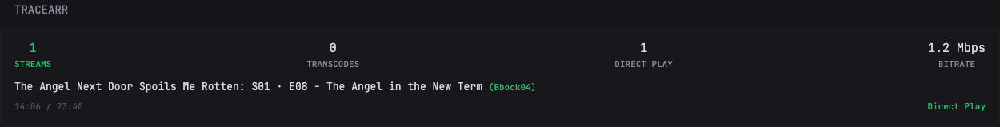

# Tracearr

Live streaming stats from your Tracearr instance, rendered directly inside Dynacat:

- Summary row: active **streams**, **transcodes**, **direct plays**, and total **bitrate**
- One line per active session: episode format (`Show: S01 · E08 - Title`) or movie title, plus the streaming username
- Per-session playback progress (`14:06 / 23:40`)
- Playback decision chip: `Transcode` (red), `Copy` (gray), or `Direct Play` (green)

No extra services needed - Dynacat calls the Tracearr API directly at render time, and the API key stays server-side in your config/env.



---

## Requirements

- A running Tracearr instance (reachable from Dynacat)
- A Tracearr API key (Bearer token)

---

## Environment Variables

Add the following to your Dynacat `.env` file:

| Variable | Description |
|----------|-------------|
| `TRACEARR_URL` | Base URL of your Tracearr instance, e.g. `http://192.168.1.173:3001` |
| `TRACEARR_KEY` | Your Tracearr API key |

The widget fetches `${TRACEARR_URL}/api/v2/public/streams` (set as the default in the `required:` section, overridable with `url:` in your config).

---

## Configuration

```yaml
- type: dynawidgets
  widget: tracearr
  headers:
    Authorization: Bearer ${TRACEARR_KEY}
  update-interval: 30s
```

> **Note:** the `required:` section currently only supplies the default `url` - the `Authorization` header must be set in your config as shown above.

Works with plain-HTTP LAN instances out of the box. For Tracearr behind a self-signed HTTPS certificate, add `allow-insecure: true`.

---

## Behavior notes

- The decision chip shows the worst component: any transcode (video or audio) wins and renders red, then `Copy`, then `Direct Play`.
- Sessions without progress data yet display `0:00 / 0:00` (a deliberate touch).
- `update-interval: 2s` gives near-live updates; higher values are gentler on the Tracearr API.
- The `STREAMS` value turns green when at least one stream is active.
- When nothing is playing, the widget shows "No active sessions" instead of the session list (summary row still renders).

---

## Troubleshooting

**Widget shows an error / no data**
- Confirm `TRACEARR_URL` and `TRACEARR_KEY` are set in the container environment.
- Test the API from the Dynacat host: `curl -H "Authorization: Bearer $TRACEARR_KEY" $TRACEARR_URL/api/v2/public/streams`
- If the key has trailing whitespace (e.g. copied from a CRLF file), clean it - some HTTP stacks reject the request outright.

**Self-signed certificate errors**
- Add `allow-insecure: true` to the widget config.
